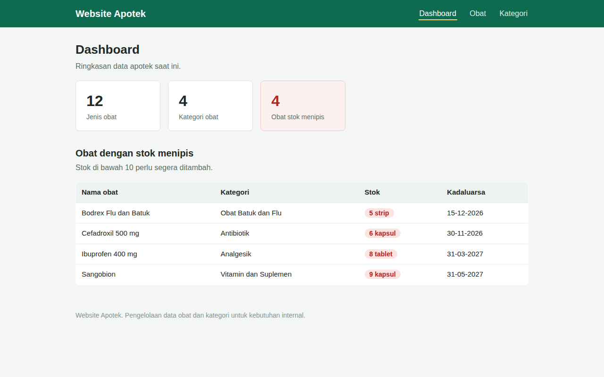

# Website Apotek

Website pengelolaan data apotek berbasis Laravel 12. Aplikasi ini dipakai untuk mencatat kategori dan obat beserta stok, harga, dan tanggal kadaluarsanya. Data contoh tersedia lewat seeder sehingga aplikasi bisa langsung dicoba setelah instalasi.

## Fitur

- Dashboard ringkas berisi jumlah obat, jumlah kategori, dan jumlah obat dengan stok menipis
- Daftar obat dengan stok menipis pada dashboard, yaitu obat dengan stok di bawah 10
- CRUD kategori obat dengan nama dan deskripsi
- CRUD obat dengan nama, kategori, satuan, stok, harga, dan tanggal kadaluarsa
- Pencarian obat berdasarkan nama pada halaman daftar obat
- Penanda merah untuk stok yang menipis pada daftar obat dan dashboard
- Validasi form dasar pada semua masukan
- Seeder berisi 4 kategori dan 12 obat contoh

## Teknologi

- PHP 8.2 atau lebih baru
- Laravel 12
- Blade dengan CSS buatan sendiri tanpa Vite dan tanpa CDN
- SQLite sebagai database

## Cara Instalasi

Prasyarat:

- PHP 8.2 atau lebih baru dengan ekstensi pdo_sqlite
- Composer

Langkah instalasi:

```bash
git clone https://github.com/bintangyudhis/website-apotek.git
cd website-apotek
composer install
cp .env.example .env
php artisan key:generate
touch database/database.sqlite
php artisan migrate --seed
```

Perintah `migrate --seed` membuat tabel sekaligus mengisi 4 kategori dan 12 obat contoh.

## Cara Menjalankan

Jalankan server pengembangan Laravel:

```bash
php artisan serve
```

Buka `http://localhost:8000` di browser. Halaman utama menampilkan dashboard, sedangkan data obat dan kategori bisa dibuka dari navigasi di bagian atas.

## Batasan Saat Ini

- Belum ada autentikasi, jadi semua halaman bisa dibuka tanpa masuk
- Belum ada fitur transaksi, penjualan, atau kasir
- Harga dicatat sebagai bilangan bulat dalam rupiah

## Tangkapan Layar



## Lisensi

Proyek ini memakai lisensi MIT. Lihat berkas [LICENSE](LICENSE) untuk teks lengkapnya.
